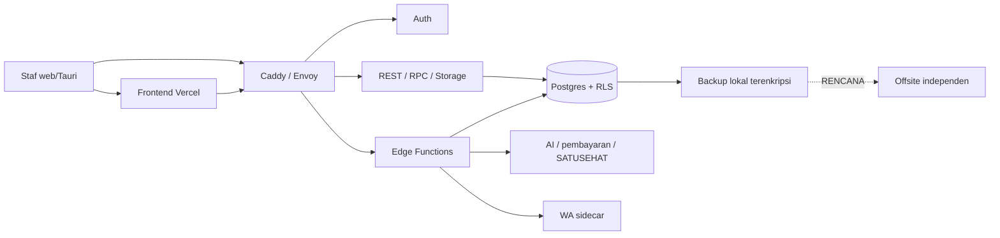

# Model Ancaman STRIDE

**DRAF — perlu ditinjau advokat/DPO/auditor**

Versi 1.0 · Tanggal 2026-10-17 · Pemilik: Ketua Tim dan fungsi privasi yang ditunjuk.
Periode tinjau: tahunan, setelah insiden/perubahan material; tinjau awal sebelum disahkan.
Status: usulan internal; tidak ada klaim sertifikasi atau audit independen.

## Ruang lingkup dan aset
Data identitas/klinis, transaksi, sesi, secrets, backup, audit dan usulan agen.
S/T/R/I/D/E = pemalsuan, manipulasi, penyangkalan, kebocoran, gangguan, eskalasi.
Skor kemungkinan/dampak 1–5 adalah penilaian awal tim, bukan statistik: 1 jarang/
terbatas, 3 masuk akal/signifikan, 5 sangat mungkin/kritis. ≥15 prioritas tinggi,
8–14 sedang, ≤7 rendah. Risiko residu baru dinilai setelah bukti mitigasi tersedia.

Batas kepercayaan: perangkat staf, internet/gateway, jaringan layanan internal,
hak database, penyedia eksternal dan akun pengelola. Frontend bukan batas keamanan.
Vercel melayani aset; isi RME tetap berpotensi melewati layanan jaringan/browser
dan log, sehingga “semua data selalu di Indonesia” tidak dapat dijanjikan.

| Komponen | STRIDE | Ancaman | Mitigasi berbukti | Celah | Skor awal | Rekomendasi |
|---|---|---|---|---|---:|---|
| Web/desktop | S,T,I | Pencurian sesi/XSS membaca data peran | E09 CSP, E02 izin | Token/draft/perangkat bersama | 4×5=20 | TOTP+AAL2, auto-lock, sanitasi, uji role |
| Gateway/Auth | S,D,E | Credential stuffing atau assurance turun | E03,E08 | Rate-limit Envoy/audit login belum lengkap | 4×5=20 | Batas laju dan pengujian bypass, alert login |
| PostgREST/RPC | T,I,E | ID lintas tenant atau SECURITY DEFINER meluas | E01,E02 | Regresi argumen tenant | 3×5=15 | Dua tenant, cek search_path/EXECUTE, negative tests |
| Postgres/Storage | T,R,I | Objek Storage publik/ubah log oleh hak tinggi | E01,E04 | Jangkar eksternal log belum ada | 3×5=15 | Uji policy objek, ekspor kepala rantai |
| Edge functions | S,T,D,E | Webhook palsu, replay, secret terlalu luas | E10 dan router infra | Inventaris validasi setiap webhook | 3×5=15 | Signature/replay/idempotensi per integrasi |
| WhatsApp sidecar | S,I,D | Profil sesi bocor atau nomor salah | E08 dan README WhatsApp | Sesi berisi riwayat, layanan tidak resmi | 3×5=15 | Isolasi host, redaksi, evaluasi kanal resmi |
| AI/vendor | T,I,E | Instruksi berbahaya di data alat dan prompt | E10 usul→persetujuan | Keluaran model nondeterministik | 4×4=16 | G6 injection, minimisasi payload, server allowlist |
| CI/CD/dependency | T,E | Paket berbahaya atau secret di artefak | CI sumber dan lockfile | SBOM/scan menyeluruh belum terpasang | 3×5=15 | Pin dependency, secret scan, SBOM, review rilis |
| Backup/kunci | T,I,D | Disk VPS hilang bersama backup atau key hilang | E05 age dan manifest | Satu lokasi, restore belum diukur baru | 4×5=20 | Offsite independen dan gladi pulih |
| Operator/vendor | S,R,I,E | Akun operator/penyedia disalahgunakan | E12 dan E08 | Akses darurat dan DPA belum disahkan | 3×5=15 | Persetujuan akses sementara, audit, review vendor |

## Pemilik dan uji risiko
Ketua memegang backend/infra; Antigravity UI/CI usulan; klinik menentukan hak staf;
fungsi privasi menilai transfer/DPIA. Setiap mitigasi punya tiket, bukti uji dan
penerimaan residu tertulis. Skenario lintas clinic_id, replay apply, expired usulan,
token TV, Storage dan akun non-admin diuji di staging sintetis, bukan produksi.
