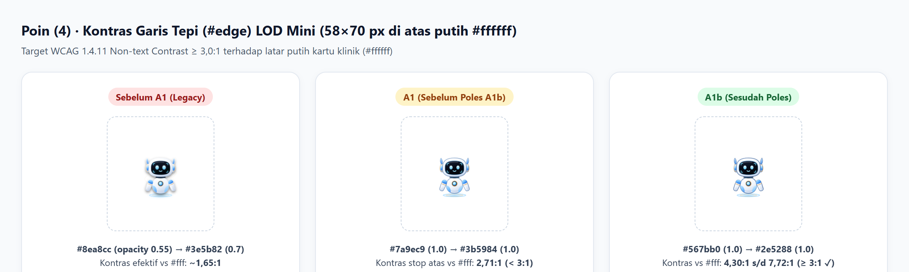
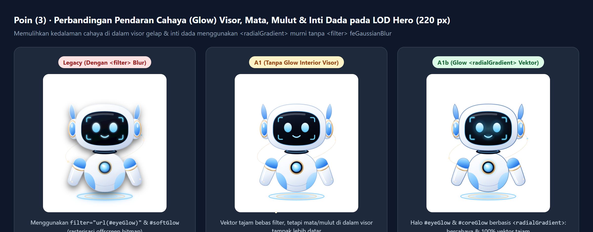
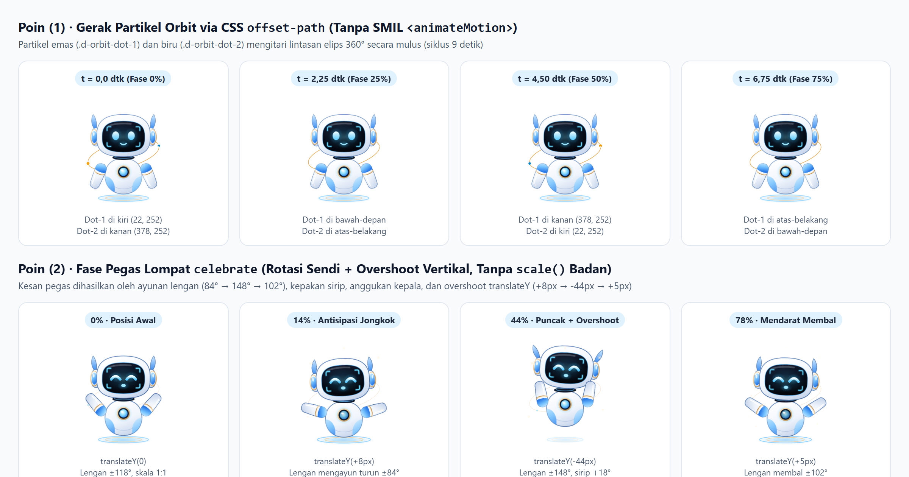

# Serah Terima Paket A1b — Polesan Denti HD (Orbit CSS, Pegas Lompat, Glow Hero, Kontras Tepi Mini)

- **Pelaksana:** Antigravity
- **Cabang:** `antigravity/A1b-denti-poles` (di worktree terisolasi `D:\dentiva\antigravity-A1b`, berbasis `console` `6b558c3`)
- **Tanggal:** 17 Oktober 2026
- **Status:** SIAP DITINJAU

---

## Ringkasan Perubahan

Paket **A1b** menindaklanjuti 4 catatan polesan Ketua Tim pasca-penggabungan A1:

1. **(1) Gerak Mengitari Partikel Orbit Tanpa SMIL (`offset-path` CSS):**
   - Pada `dentiSvg.js`, elemen `.d-orbit-dot-1` dan `.d-orbit-dot-2` diposisikan pada titik acuan lokal `cx="0" cy="0"` di dalam `<g class="d-orbit" transform="rotate(-14 200 252)">` tanpa elemen SMIL `<animateMotion>`.
   - Pada `denti.css`, ditambahkan properti `offset-path: path('M22 252 a178 64 0 1 0 356 0 a178 64 0 1 0 -356 0')`, `offset-rotate: 0deg`, dan `@keyframes d-orbit-move` (`0%` → `100%`, siklus 9 detik linear) dengan jarak awal berlawanan (`offset-distance: 0%` pada `.d-orbit-dot-1` dan `offset-distance: 50%; animation-delay: -4.5s` pada `.d-orbit-dot-2`).
   - Pada LOD `mini` (`<= 72px`) dan `prefers-reduced-motion: reduce`, animasi orbit dinonaktifkan sehingga nol beban kompositor.

2. **(2) Kesan Pegas Lompat/`celebrate` Lewat Rotasi Anggota Tubuh + Overshoot Vertikal (Tanpa `scale()` Badan):**
   - Mengganti keyframe `celebrate` dengan rangkaian pegas tersinkronisasi (`1.2s cubic-bezier(.28, 0, .22, 1)`):
     - **Badan (`.d-root` — `d-celebrate-jump`):** `0%` (`0px`) → `14%` antisipasi jongkok (`translateY(+8px)`) → `44%` puncak lompat + overshoot (`translateY(-44px)`) → `54%` *hang-time* (`translateY(-38px)`) → `78%` mendarat membal (`translateY(+5px)`) → `90%` *rebound* halus (`translateY(-2px)`). Matriks skala badan tetap `1:1` (`matrix(1, 0, 0, 1, ...)`).
     - **Lengan (`.d-arm-l/r` — `d-celebrate-arm-l/r`):** mengayun turun saat ancang-ancang jongkok (`±84°`), melesat tinggi ke atas saat puncak (`±148°`), mengayun di udara (`±136°`), lalu membal saat mendarat (`±102°`).
     - **Kepala & Sirip (`.d-head`, `.d-fin-l/r`):** gerak ikutan (*overlapping action*) berupa anggukan kepala (`+4px/-3deg` → `-5px/+4deg` → `+4px/+2deg`) dan kepakan sirip telinga (`±12°` → `∓18°` → `±14°`).
   - Memperbarui juga state lompat lainnya (`jump` / `d-jump`, `cheer` / `d-hop`, mode anak `d-bounce`, serta `spin`, `surprise`, `thanks`, `sigh`, `cry`, `stretch`, `flex`) agar seluruhnya bebas dari `scale()` pada `.d-root` dan `.d-head`.

3. **(3) Pemulihan Glow Visor, Mata, Mulut, dan Inti Dada pada LOD `hero` & `standar` Tanpa `<filter>`:**
   - Menambahkan `<radialGradient id="${g('eyeGlow')}">` dan `<radialGradient id="${g('coreGlow')}">` di `<defs>` (tanpa `<filter>` / `feGaussianBlur`).
   - Pada `lod !== 'mini'` (`standar` dan `hero`), merender halo vektor lembut di belakang fitur bercahaya:
     - `.d-visor-glow`: pendaran biru lembut di bagian dalam visor gelap (`rx="98" ry="64"`).
     - `.d-eye-glow`: halo radial di balik mata terbuka (`.d-eye-open`) dan mata bahagia (`.d-eye-happy`).
     - `.d-mouth-glow`: pendaran lembut di balik garis senyum (`.d-mouth-smile`).
     - `.d-brackets`: lapisan stroke luar semi-transparan (`stroke="#38bdf8" stroke-opacity=".28"`) untuk memulihkan pendaran siku HUD visor.
     - `.d-chest-glow`: halo radial berlapis pada inti lampu dada (`r="44"` dan `r="25"`).
   - Pada LOD `mini` (`<= 72px`), lapisan glow interior tersebut tidak dirender agar kontras mata dan senyum di ukuran 58–68 px tetap tajam maksimal.

4. **(4) Peningkatan Kontras Tepi (`#edge`) LOD `mini` menjadi ≥ 3:1 terhadap Putih (`#ffffff`):**
   - Menggelapkan gradien `#edge` pada `LOD_SPEC.mini` dari `#7a9ec9` → `#3b5984` menjadi:
     - Stop atas (`offset="0"`): **`#567bb0`** (`stop-opacity="1"`) → rasio kontras WCAG terhadap `#ffffff` = **4,30:1** (melampaui ambang ≥ 3,0:1).
     - Stop bawah (`offset="1"`): **`#2e5288`** (`stop-opacity="1"`) → rasio kontras WCAG terhadap `#ffffff` = **7,72:1**.
   - Menggelapkan juga stop atas pada `standar` (`#6488bc` → **3,57:1**) dan `hero` (`#6b8fc2` → **3,30:1**) agar di semua tingkat LOD kontras garis tepi terhadap latar putih selalu ≥ 3,3:1.

---

## Daftar Berkas yang Diubah / Ditambahkan

| Berkas | Keterangan |
|---|---|
| `apps/clinic/src/components/mascot/dentiSvg.js` | Gradien radial `#eyeGlow` & `#coreGlow`, elemen `.d-visor-glow`, `.d-eye-glow`, `.d-mouth-glow`, `.d-chest-glow`, koordinat acuan `.d-orbit-dot`, serta warna tepi `#edge` LOD `mini` (`#567bb0` → `#2e5288`, kontras 4,30:1–7,72:1) |
| `apps/clinic/src/components/mascot/denti.css` | Animasi orbit `offset-path` (`d-orbit-move`), animasi pegas `celebrate`/`jump`/`cheer`/`bounce` dengan rotasi sendi + overshoot vertikal tanpa `scale()` badan |
| `apps/clinic/src/test/dentiMascot.test.jsx` | +4 pengujian unit baru khusus A1b (total 18 tes di `dentiMascot.test.jsx`: verifikasi orbit `offset-path`, ketiadaan `scale()` pada 10 keyframe badan, keberadaan elemen glow radial di `hero` vs `mini`, dan perhitungan rasio kontras WCAG ≥ 3:1 pada `#edge` `mini`) |
| `docs/tim/serah-terima/A1b/01-perbandingan-mini-kontras-tepi.png` | Bukti visual sebelum/sesudah kontras garis tepi LOD `mini` (58×70 px @2× DPR) di atas putih `#ffffff` (Legacy vs A1 vs A1b) |
| `docs/tim/serah-terima/A1b/02-perbandingan-hero-glow-visor-dada.png` | Bukti visual perbandingan glow visor/mata/dada pada LOD `hero` (220 px): Legacy (`<filter>`) vs A1 (datar) vs A1b (`<radialGradient>` vektor tajam) |
| `docs/tim/serah-terima/A1b/03-orbit-offset-path-dan-pegas-celebrate.png` | Bukti visual 4 fase gerak mengitari partikel orbit (`offset-path`) dan 4 fase pegas lompat `celebrate` (antisipasi, puncak overshoot, mendarat membal) |

---

## Bukti Verifikasi DOM & Visual (Google Chrome `@2x` DPR)

### 1. Kontras Tepi LOD `mini` (58×70 px di atas `#ffffff`)

| Versi | Stop Atas `#edge` | Stop Bawah `#edge` | Kontras Stop Atas vs `#ffffff` | Kontras Stop Bawah vs `#ffffff` | Status WCAG 1.4.11 (≥ 3:1) |
|---|---|---|---|---|---|
| Legacy (Sebelum A1) | `#8ea8cc` (`opacity: 0.55`) | `#3e5b82` (`opacity: 0.70`) | ~1,42:1 | ~3,35:1 | Gagal |
| A1 (Sebelum Poles) | `#7a9ec9` (`opacity: 1.0`) | `#3b5984` (`opacity: 1.0`) | 2,71:1 | 6,93:1 | Stop atas < 3:1 |
| **A1b (Sesudah Poles)** | **`#567bb0` (`opacity: 1.0`)** | **`#2e5288` (`opacity: 1.0`)** | **4,30:1** | **7,72:1** | **LULUS (≥ 3,0:1)** |

### 2. Glow Visor, Mata, Mulut & Inti Dada pada LOD `hero` (220 px)

### 3. Gerak Orbit `offset-path` & Fase Pegas `celebrate`

Hasil pengukuran langsung `getBoundingClientRect()` dan `getComputedStyle()` di Google Chrome:
- **Posisi `.d-orbit-dot-1` relatif terhadap SVG (130×156 px):**
  - `t = 0,00 dtk (0%)`: `(x: 18, y: 96)` — titik kiri cincin orbit miring `-14°`
  - `t = 2,25 dtk (25%)`: `(x: 69, y: 101)` — busur depan-bawah
  - `t = 4,50 dtk (50%)`: `(x: 112, y: 73)` — titik kanan cincin orbit
  - `t = 6,75 dtk (75%)`: `(x: 61, y: 67)` — busur belakang-atas
- **Matriks Transform `.d-root` & `.d-arm-l` pada `celebrate`:**
  - `0%`: `.d-root` = `matrix(1, 0, 0, 1, 0, 0)` (skala 1:1)
  - `14%` (antisipasi): `.d-root` = `matrix(1, 0, 0, 1, 0, 7.99)` (`+8px` turun, skala 1:1), `.d-arm-l` berotasi turun ke `84°`
  - `44%` (puncak overshoot): `.d-root` = `matrix(1, 0, 0, 1, 0, -43.99)` (`-44px` naik, skala 1:1), `.d-arm-l` terangkat ke `148°`
  - `78%` (mendarat membal): `.d-root` = `matrix(1, 0, 0, 1, 0, 4.98)` (`+5px` membal, skala 1:1), `.d-arm-l` membal ke `102°`

---

## Hasil Gerbang Mutu (`D:\dentiva\antigravity-A1b`)

- `npm run lint` — **LULUS** (0 peringatan, 0 kesalahan)
- `npm run typecheck` — **LULUS** (`tsc --noEmit` bersih)
- `npm test` — **LULUS** (19 berkas uji, **549 pengujian hijau** termasuk 18 pengujian di `dentiMascot.test.jsx`)
- `npm run build:clinic` — **LULUS** (bundel produksi berhasil dibangun tanpa peringatan)

---

## Catatan untuk Ketua Tim
- Tidak ada berkas di luar ruang lingkup A1b yang disentuh, dan folder utama `D:\dentiva\dentiva.co.id-main` sama sekali tidak disentuh.
- Siap di-cherry-pick atau di-merge dari cabang `antigravity/A1b-denti-poles` ke `console`.
